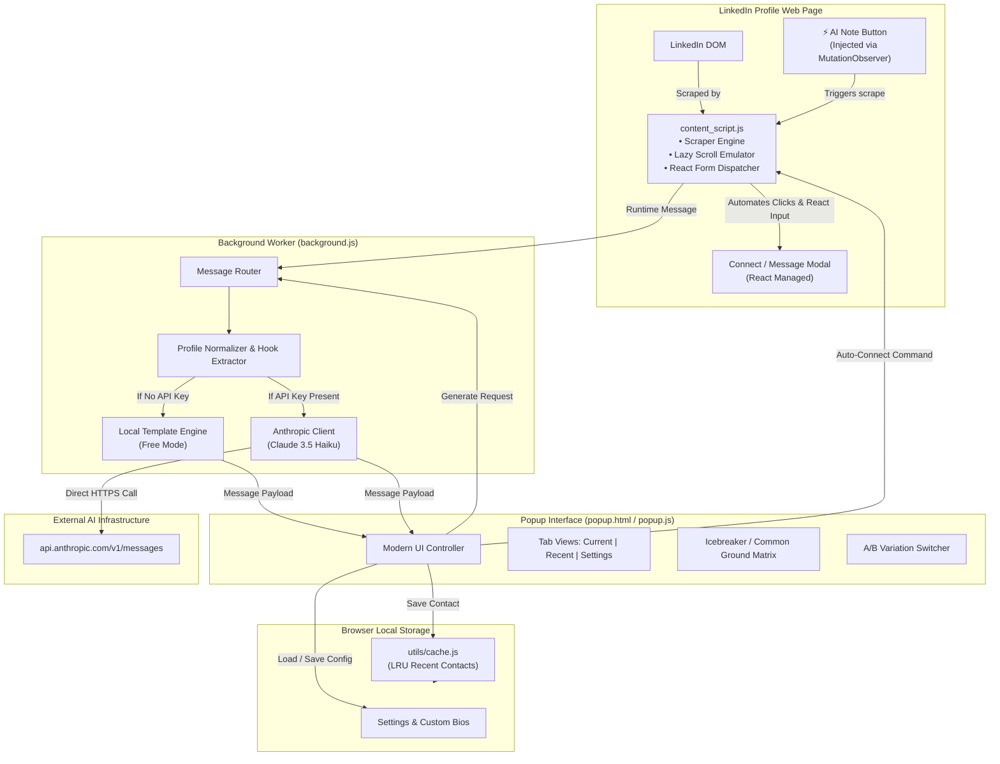
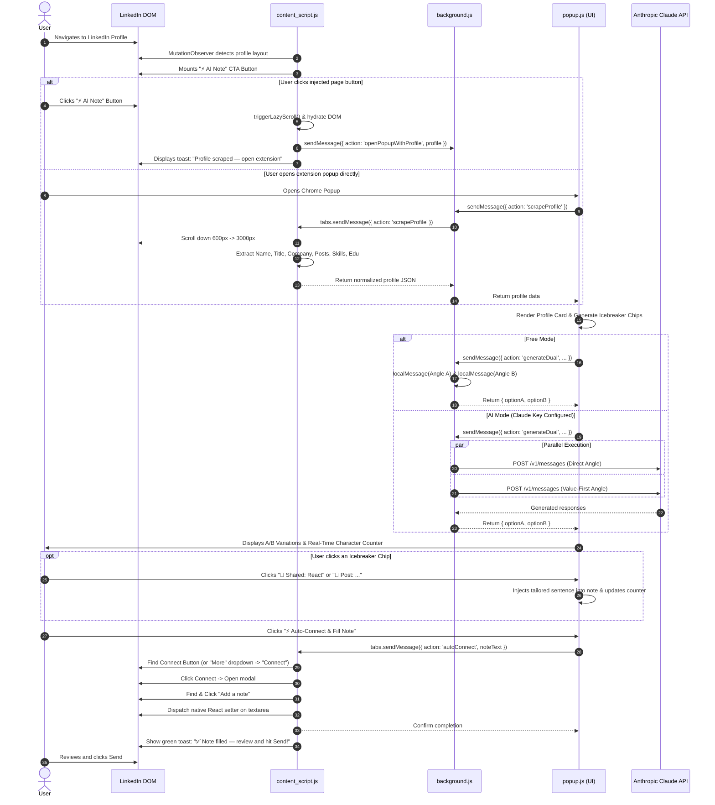
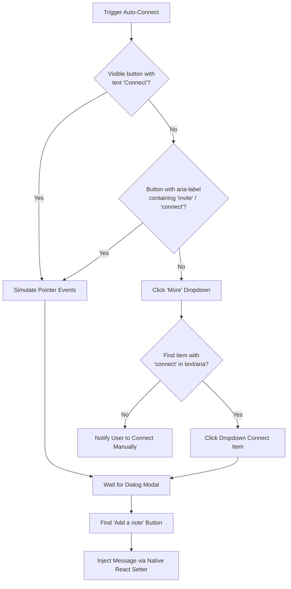

# LinkedIn Outreach AI — Chrome Extension

> **Version 3.1.0** · Next-generation AI-powered LinkedIn outreach assistant. Generates hyper-personalized connection notes and direct messages in seconds — with zero license key required.

<p align="center">
  
</p>

<p align="center">
  <a href="#overview"></a>
  <a href="#manifest-v3"></a>
  <a href="#privacy--security"></a>
  <a href="#technology-stack"></a>
  <a href="#license"></a>
</p>

---

## 📑 Table of Contents

1. [Executive Summary & Overview](#executive-summary--overview)
2. [What Was Upgraded & Enhanced (v1/v2 vs v3.1.0)](#what-was-upgraded--enhanced-v1v2-vs-v310)
   - [Comparative Upgrade Matrix](#comparative-upgrade-matrix)
   - [Deep Dive: Why These Enhancements Matter](#deep-dive-why-these-enhancements-matter)
3. [Visual Architecture & System Design](#visual-architecture--system-design)
   - [System Topology (Mermaid)](#system-topology)
   - [End-to-End Sequence Diagram (Mermaid)](#end-to-end-sequence-diagram)
   - [Scraper & Hydration State Machine (Mermaid)](#scraper--hydration-state-machine)
4. [Core Features Breakdown](#core-features-breakdown)
   - [1. Dual-Engine Generation (Free Mode vs. AI Mode)](#1-dual-engine-generation-free-mode-vs-ai-mode)
   - [2. A/B Simultaneous Variation Generator](#2-ab-simultaneous-variation-generator)
   - [3. Interactive Icebreakers & Common Ground Matrix](#3-interactive-icebreakers--common-ground-matrix)
   - [4. Three-Layer Deep Analysis Pipeline (L1 / L2 / L3)](#4-three-layer-deep-analysis-pipeline-l1--l2--l3)
   - [5. One-Click Auto-Connect & DOM Form Injector](#5-one-click-auto-connect--dom-form-injector)
   - [6. Persistent In-Page Overlay Button](#6-persistent-in-page-overlay-button)
   - [7. Dual Message Types & Adaptive Character Budgeting](#7-dual-message-types--adaptive-character-budgeting)
   - [8. Sliding-Window Contact History & Message Stash](#8-sliding-window-contact-history--message-stash)
5. [Under the Hood: Engineering & DOM Mechanics](#under-the-hood-engineering--dom-mechanics)
   - [The Multi-Tiered LinkedIn Scraper](#the-multi-tiered-linkedin-scraper)
   - [React Synthetic Event Emulation](#react-synthetic-event-emulation)
   - [Resilient Connect Button Discovery](#resilient-connect-button-discovery)
6. [Directory Structure](#directory-structure)
7. [Installation & Setup](#installation--setup)
8. [Configuration Guide](#configuration-guide)
9. [Privacy, Data Governance & Security](#privacy-data-governance--security)
10. [Troubleshooting & FAQ](#troubleshooting--faq)
11. [Development & Debugging](#development--debugging)

---

## Executive Summary & Overview

**LinkedIn Outreach AI** is an enterprise-grade Chrome Extension built on Manifest V3 engineered to eliminate generic, robotic outreach. By inspecting structured DOM landmarks on LinkedIn profile pages—including current position, tenure, career trajectories, published articles, posts, verified skills, and shared educational backgrounds—it synthesizes contextually rich, conversational outreach notes tailored to exact engagement objectives.

Unlike legacy extension tools that force users to purchase proprietary subscription plans or rely solely on external server-side scrapers, **LinkedIn Outreach AI** features:
- **Zero Lock-In**: Complete built-in offline heuristic template generator (**Free Mode**).
- **Direct-to-Model Connectivity**: Connects directly from the browser to Anthropic's Claude 3.5 Haiku API (**AI Mode**) without proxy servers.
- **Client-Side Storage**: User credentials, target bios, and contact logs never leave `chrome.storage.local`.

---

## What Was Upgraded & Enhanced (v1/v2 vs v3.1.0)

### Comparative Upgrade Matrix

| Capability | Legacy Version (v1.0 - v2.0) | Upgraded Version (v3.1.0) | Technical & User Impact |
| :--- | :--- | :--- | :--- |
| **Monetization & Access** | Hard paywall / Required license key or server API auth | **Zero mandatory keys**; Instant Free Mode with optional Anthropic Claude API | Removes all friction during onboarding; works immediately after installation. |
| **Generation Architecture** | Single synchronous generation call; one static output | **Parallel Dual-Angle (A/B) Generation** via `Promise.all` | Delivers two opposing outreach styles (*Direct* vs. *Value-First*) in a single click. |
| **DOM Scraping Engine** | Static `querySelector` calls on initial render; fails on unhydrated cards | **MutationObserver + Simulated Progressive Lazy-Scroll** | Triggers LinkedIn's virtualized list and React state hydration for hidden experience and skills. |
| **React Form Insertion** | Simple `.value = text` assignment (silently discarded by LinkedIn) | **Prototype Descriptor Patch (`Object.getOwnPropertyDescriptor`)** | Dispatches native `input` and `change` events compatible with React's synthetic event dispatcher. |
| **Profile Engagement** | Passive generation only inside the popup | **In-Page Injected `⚡ AI Note` CTA button** | Directly mounted onto LinkedIn's action row via DOM observer. |
| **Outreach Automation** | Manual copy-pasting into LinkedIn modal | **Automated Multi-Step Connect Workflow** | Finds Connect button (or More dropdown), opens modal, triggers note form, and pastes text. |
| **Contextual Relevance** | Generic `{name}` and `{company}` tokens | **Semantic Icebreaker & Common Ground Detection** | Extracts post quotes, shared skills against user bio, alma mater, and past companies. |
| **Length Validation** | Fixed text area with no length warning | **Adaptive Character Budgeter** (Strict 300 char connection note vs. freeform DM) | Displays real-time warnings at 270 characters and error status if 300-character LinkedIn limit is exceeded. |
| **Persistence** | Volatile; closing the popup wiped all data | **LRU Local Contact Cache (`utils/cache.js`)** | Saves last 5 generated contacts with expand/collapse and instant copy buttons. |
| **Design Language** | Generic browser extension styling | **Refined Warm-Editorial UI Theme** | High-contrast visual hierarchy, status pulses, and distinct color accents for pipelines. |

---

### Deep Dive: Why These Enhancements Matter

#### 1. Overcoming LinkedIn's Virtualized Rendering
Modern LinkedIn profiles dynamically load HTML sections only when scrolled into the viewport. Legacy scrapers frequently missed experience details, about descriptions, and recent activities. In **v3.1.0**, `content_script.js` executes `triggerLazyScroll()` through five calculated offsets (`[600, 1200, 1800, 2400, 3000]px`), coupled with a `MutationObserver` waiting for `waitForSectionHydration()`. This guarantees high data fidelity before parsing.

#### 2. React Controlled Components Compatibility
Modern SPAs like LinkedIn override `<textarea>` and `<input>` elements with React state bindings. If a script updates `el.value = "text"`, React's internal state tracker fails to detect changes, resetting the field as soon as the user focuses it. In **v3.1.0**, the extension queries the native prototype:
```javascript
const proto = window.HTMLTextAreaElement.prototype;
const nativeSetter = Object.getOwnPropertyDescriptor(proto, 'value')?.set;
nativeSetter.call(el, text);
el.dispatchEvent(new InputEvent('input', { bubbles: true, cancelable: true }));
el.dispatchEvent(new Event('change', { bubbles: true }));
```
This forces React's internal fiber node to accept and register the injected text.

#### 3. Dual-Pillar Behavioral Psychology (A/B Angle Generation)
Outreach success heavily depends on recipient seniority:
- **Direct Angle (Option A)**: High-efficiency, low-friction. Perfect for busy executives, founders, and recruiters who appreciate brevity.
- **Value-First Angle (Option B)**: Observation-led. Cites an article, recent post, or technical skill before posing an inquiry. Ideal for engineers, researchers, and peers.
Generating both simultaneously allows the sender to choose the most effective approach without running separate workflows.

---

## Visual Architecture & System Design

### System Topology



---

### End-to-End Sequence Diagram



---

### Scraper & Hydration State Machine

```mermaid
stateDiagram-v2
    [*] --> Idle: Extension Loaded
    Idle --> LandmarkCheck: Profile Navigation Detected
    
    state LandmarkCheck {
        [*] --> CheckH1: Locate <h1> (Profile Name)
        CheckH1 --> CheckSections: Verify presence of <section>
        CheckSections --> LandmarksFound: Elements Confirmed
        CheckSections --> Timeout: Exceeds 8000ms
    }

    LandmarkCheck --> LazyScrolling: Landmarks Confirmed
    
    state LazyScrolling {
        [*] --> ScrollStep1: Scroll to 600px
        ScrollStep1 --> ScrollStep2: 220ms pause -> 1200px
        ScrollStep2 --> ScrollStep3: 220ms pause -> 1800px
        ScrollStep3 --> ScrollStep4: 220ms pause -> 2400px
        ScrollStep4 --> ScrollStep5: 220ms pause -> 3000px
        ScrollStep5 --> ObserverWait: Sections triggered
    }

    LazyScrolling --> SectionHydration: Listen to DOM Mutations
    
    state SectionHydration {
        [*] --> CountSections: Monitor <section> tags
        CountSections --> Verified: count >= 3 && elapsed > 800ms
        CountSections --> MaxWait: Timeout (5000ms)
    }

    SectionHydration --> Extraction: Scroll reset to top
    
    state Extraction {
        [*] --> ScrapeNameHeadline
        ScrapeNameHeadline --> ScrapeExperience
        ScrapeExperience --> ScrapeSkills
        ScrapeSkills --> ScrapePosts
        ScrapePosts --> DeduplicateNormalize
    }

    Extraction --> [*]: Return Structured JSON
```



---

## Core Features Breakdown

### 1. Dual-Engine Generation (Free Mode vs. AI Mode)

The extension contains two independent message generation engines:

1. **Free Engine (Heuristic Template Compiler)**:
   - Evaluates parsed recipient hooks against sender bio, recipient headline, current organization, and recent publications.
   - Tailors greetings and sign-offs dynamically based on the selected tone (`Formal`: *"Dear {Name},"*, `Neutral`: *"Hi {Name},"*, `Casual`: *"Hey {Name}!"*).
   - Tailors actionable CTAs based on message type (`Networking`, `Job Opportunity`, `Referral Request`, `Collaboration`).
   - Requires zero external credentials, operates with zero latency, and runs 100% locally.

2. **AI Engine (Claude 3.5 Haiku)**:
   - Activated automatically when an Anthropic API key is added in Settings.
   - Utilizes `claude-3-5-haiku-20241022`, delivering high contextual awareness and natural phrasing at high processing speeds.
   - Uses strict token budgeting (120 tokens for connection notes; 400 tokens for InMail/DMs) to eliminate verbose AI preambles.

---

### 2. A/B Simultaneous Variation Generator

Clicking **⚡ Generate A/B Variations** executes two concurrent prompt pipelines:
- **Option A (Direct & Low-Friction)**: States intent clearly in the opening lines. Best suited for high-level decision makers.
- **Option B (Value-First & Observational)**: References an achievement, recent post, or shared skill before proposing a conversation.
Users can seamlessly toggle between tabs, comparing character counts and tonality before copying or auto-filling.

```
┌────────────────────────────────────────────────────────┐
│  A/B Variations                                        │
│  [ A — Direct (Active) ]   [ B — Value-first ]         │
├────────────────────────────────────────────────────────┤
│  Option A: Direct & low-friction — straight to ask.    │
│  Hi Sarah, I came across your work leading product at  │
│  FinTechX. I'm exploring PM opportunities in fintech   │
│  and would value a quick chat. — Jane                  │
│                                                        │
│  [ Copy ]  [ Insert ]                      184 / 300   │
└────────────────────────────────────────────────────────┘
```

---

### 3. Interactive Icebreakers & Common Ground Matrix

The extension surfaces contextual relationship hooks directly beneath the profile header:

```
┌──────────────────────────────────────────────────────────┐
│ ⚡ COMMON GROUND & ICEBREAKERS   Click any pill to weave │
│ ┌──────────────────┐ ┌─────────────────────────────────┐ │
│ │ 🤝 Shared: React │ │ 💬 Post: "Scaling vector db…"   │ │
│ └──────────────────┘ └─────────────────────────────────┘ │
│ ┌────────────────────────┐ ┌───────────────────────────┐ │
│ │ 🏢 At Stripe           │ │ 🎓 Stanford University    │ │
│ └────────────────────────┘ └───────────────────────────┘ │
└──────────────────────────────────────────────────────────┘
```

Clicking any chip dynamically modifies the active draft:
- Extracts the first name and respects the active tone setting.
- Matches and replaces existing introductory clauses while preserving the core call-to-action.
- Displays a visual checkmark confirmation (`✓ Injected!`) upon injection.

---

### 4. Three-Layer Deep Analysis Pipeline (L1 / L2 / L3)

For complex networking scenarios, **Deep Mode** breaks the analysis into visual, sequential stages:

```
┌────────────────────────────────────────────────────────┐
│  3-LAYER AI PIPELINE                                   │
│  [L1] Profile Parser       ● Done     Structured DOM   │
│  [L2] Web Enrichment       ● Done     Found 3 hooks    │
│  [L3] Message Synthesis    ● Ready    Waiting to write │
│                                                        │
│  ⚡ Top hooks found:                                   │
│  → Recent post: "Thoughts on local-first database..." │
│  → Works as Staff Architect at Vercel                  │
│  → Skilled in TypeScript, Next.js, Rust                │
│                                                        │
│  [ Scrape + Enrich (L1+L2) ]  [ Generate Message (L3) ]│
└────────────────────────────────────────────────────────┘
```

- **Layer 1 (Parser)**: Converts unstructured LinkedIn DOM trees into normalized JSON structures.
- **Layer 2 (Enrichment)**: Identifies notable career milestones, recent thought leadership, and key focus areas.
- **Layer 3 (Writer)**: Synthesizes extracted insights with sender goals to generate the final personalized message.

---

### 5. One-Click Auto-Connect & DOM Form Injector

Manual outreach workflows are time-consuming: finding the button, opening the modal, clicking "Add a note", pasting text, and reviewing. 

**Auto-Connect** fully automates these preliminary steps:
1. Scans the profile top card for primary `Connect` buttons.
2. If omitted, opens the `More` dropdown menu and inspects hidden actions.
3. Automatically opens the dialog modal and triggers the `Add a note` action.
4. Locates the custom note textarea and injects the text using React-safe setters.
5. Halts cleanly on the final preview screen, leaving the user in full control to click **Send**.

---

### 6. Persistent In-Page Overlay Button

A non-intrusive **⚡ AI Note** action button is injected directly into the LinkedIn profile header:
- Placed beside native action elements (`Connect`, `Message`, `More`).
- Automatically re-mounts on Single-Page Application (SPA) route changes via `MutationObserver`.
- Instantly scrapes page context and stages the message inside the extension workspace.

---

### 7. Dual Message Types & Adaptive Character Budgeting

```
┌────────────────────────────────────────────────────────┐
│  [ 🔗 Connection Note ]      [ 💬 Direct Message ]     │
│  Limit: 300 Characters       Limit: None (InMail/DM)   │
└────────────────────────────────────────────────────────┘
```

- **Connection Note**:
  - Enforces LinkedIn's strict 300-character invitation limit.
  - Formats output as a single compact paragraph.
  - Real-time character counter turns **amber at 270 characters** and **red at 301+ characters**.
- **Direct Message**:
  - Formatted for full InMail or direct messaging threads.
  - Multi-paragraph structure: Greeting, Context, Value Proposition, Call-to-Action, and Sign-off.

---

### 8. Sliding-Window Contact History & Message Stash

Located in the **Recent** tab, the extension maintains an LRU (Least Recently Used) cache storing the last 5 contacted profiles:
- Displays contact name, professional headline, company, and outreach date.
- Expandable message previews (`Show full message` / `Show less`).
- One-click copy buttons for quick re-use.
- De-duplicates records automatically by `profileUrl`.

---

## Under the Hood: Engineering & DOM Mechanics

### The Multi-Tiered LinkedIn Scraper

```javascript
// Progressive Section Scraping Architecture
async function scrapeWithObserver() {
  await waitForProfileLandmarks();   // Asserts <h1> and baseline layout exist
  triggerLazyScroll();              // Programmatically triggers virtualized lists
  await waitForSectionHydration();   // Observes <section> additions via MutationObserver
  window.scrollTo({ top: 0, behavior: 'instant' });
  return scrapeProfile();           // Extracts and normalizes structured content
}
```

The scraper navigates diverse layout variations across regular, Creator Mode, and LinkedIn Recruiter profiles:
- **Name Extraction**: Falls back to `document.title.split('|')[0]` if standard header tags are obfuscated.
- **Headline Extraction**: Parses text containers using job-title regular expressions (`manager|engineer|analyst|developer|founder|director|lead...`).
- **Experience Parser**: Automatically separates company, title, tenure, and location lines, differentiating current roles from previous experience.
- **Skills Sanitization**: Strips UI artifacts (such as *"Show all skills"*, *"Endorse"*, and numeric counters).

---

### React Synthetic Event Emulation

Modern web frameworks intercept direct DOM mutations. Standard assignment (`textarea.value = text`) fails to trigger React's internal state updates.

The extension resolves this by invoking the native prototype descriptor:
```javascript
function fillReact(el, text) {
  el.focus();
  if (el.tagName === 'TEXTAREA' || el.tagName === 'INPUT') {
    const proto = el.tagName === 'TEXTAREA' 
      ? window.HTMLTextAreaElement.prototype 
      : window.HTMLInputElement.prototype;
    const nativeSetter = Object.getOwnPropertyDescriptor(proto, 'value')?.set;
    
    if (nativeSetter) {
      nativeSetter.call(el, text);
    } else {
      el.value = text;
    }
    
    el.dispatchEvent(new InputEvent('input', { bubbles: true, cancelable: true }));
    el.dispatchEvent(new Event('change', { bubbles: true }));
  } else {
    el.innerText = text;
    el.dispatchEvent(new InputEvent('input', { bubbles: true, cancelable: true }));
  }
}
```

---

### Resilient Connect Button Discovery

Different LinkedIn account types render action buttons differently. The extension uses a multi-tier fallback selector:



---

## Directory Structure

```
linkedin-outreach-ai/
├── manifest.json              # Chrome Manifest V3 configuration & permission boundaries
├── background.js              # Background service worker (API dispatch, templates, routing)
├── content_script.js          # DOM extraction engine, in-page CTA, and auto-connector
├── popup.html                 # Extension UI layout and workspace
├── popup.js                   # Application controller, state management, and UI logic
├── popup.css                  # UI design system, custom properties, and animations
├── utils/
│   └── cache.js               # LRU cache utility wrapping chrome.storage.local
└── icons/
    ├── icon16.png             # Toolbar icon
    ├── icon48.png             # Extension management icon
    └── icon128.png            # Chrome Web Store high-resolution icon
```

---

## Installation & Setup

1. **Clone or Download** this repository to your local system:
   ```bash
   git clone https://github.com/your-username/linkedin-outreach-ai.git
   ```
2. Open Google Chrome and navigate to the Extensions management console:
   ```
   chrome://extensions/
   ```
3. Enable **Developer mode** using the toggle switch in the upper-right corner.
4. Click **Load unpacked** in the top-left toolbar.
5. Select the project directory (`linkedin extention`).
6. Pin **LinkedIn Outreach AI** to your browser toolbar for quick access.

---

## Configuration Guide

Navigate to the **Settings** tab in the extension popup to configure your profile:

| Setting Field | Requirement | Purpose |
| :--- | :--- | :--- |
| **Anthropic API Key** | *Optional* | Unlocks Claude 3.5 Haiku generation. Leave empty to use Free Mode. |
| **Your Name** | *Recommended* | Used to generate accurate message sign-offs and closings. |
| **Your Bio** | *Recommended* | Informs shared-skill detection and provides background context for the AI. |
| **Target Role / Industry** | *Recommended* | Contextualizes career transition goals for referral and job inquiries. |

---

## Privacy, Data Governance & Security

- **Zero Cloud Intermediaries**: The extension operates entirely within your browser. There is no external logging or telemetry service.
- **Direct-to-Provider Security**: When using an Anthropic API key, requests travel directly from your local browser environment to `https://api.anthropic.com`.
- **Minimal Manifest Permissions**:
  - `activeTab`: Accesses the currently active LinkedIn tab upon user interaction.
  - `storage`: Preserves configurations and recent history inside local browser storage.
  - `tabs`: Validates active URLs before executing profile scrapes.
  - `scripting`: Dynamically executes content parsers if tabs are refreshed.
- **Strict Host Permissions**: Scoped strictly to `https://www.linkedin.com/*` and `https://api.anthropic.com/*`.

---

## Troubleshooting & FAQ

### Frequently Asked Questions

**Q: Do I need a paid API key to use this extension?**  
**A:** No. The extension works out of the box in **Free Mode**, using built-in heuristic templates that personalize messages using extracted profile hooks. Adding an Anthropic API key is entirely optional.

**Q: Why didn't the Auto-Connect button insert the note?**  
**A:** If you are already connected or have a pending invitation with the user, LinkedIn replaces the "Connect" button with "Message" or "Pending". In such cases, switch to **Direct Message** mode and use the standard **Insert** button.

**Q: How does the extension avoid LinkedIn account restrictions?**  
**A:** The extension does not perform automated background scraping or batch requests. It operates only on demand when viewing a profile, using human-like interaction timing (e.g., 220ms scroll delays) without violating LinkedIn rate limits.

---

### Common Error Messages & Resolutions

| Error Message | Probable Cause | Resolution |
| :--- | :--- | :--- |
| `"Please navigate to a LinkedIn profile page first."` | The current active browser tab is not on a `/in/*` profile path. | Navigate to an individual profile page (e.g., `linkedin.com/in/username`). |
| `"No active text field found on the page."` | User clicked "Insert" when no message form was open. | Open a direct message chat or connect invitation modal before clicking Insert. |
| `"Could not find Connect button."` | The member requires InMail, has connections disabled, or an invitation is pending. | Use the "More" menu manually, or switch to Direct Message mode. |
| `"API error (401)"` | The entered Anthropic API key is invalid or expired. | Check your key in Settings and click "Test" to verify connectivity. |

---

## Development & Debugging

### Inspecting Extension Components

- **Popup UI**: Right-click anywhere inside the open extension popup and choose **Inspect**.
- **Background Service Worker**: Open `chrome://extensions/`, find the extension card, and click **Inspect views: service worker**.
- **Content Script & DOM**: Open Chrome Developer Tools on any LinkedIn profile page (`F12`), switch to the **Console** tab, and set the evaluation context to the extension's content script.

---

<p align="center">
  <sub>Engineered for thoughtful, personalized, and effective professional networking.</sub>
</p>
